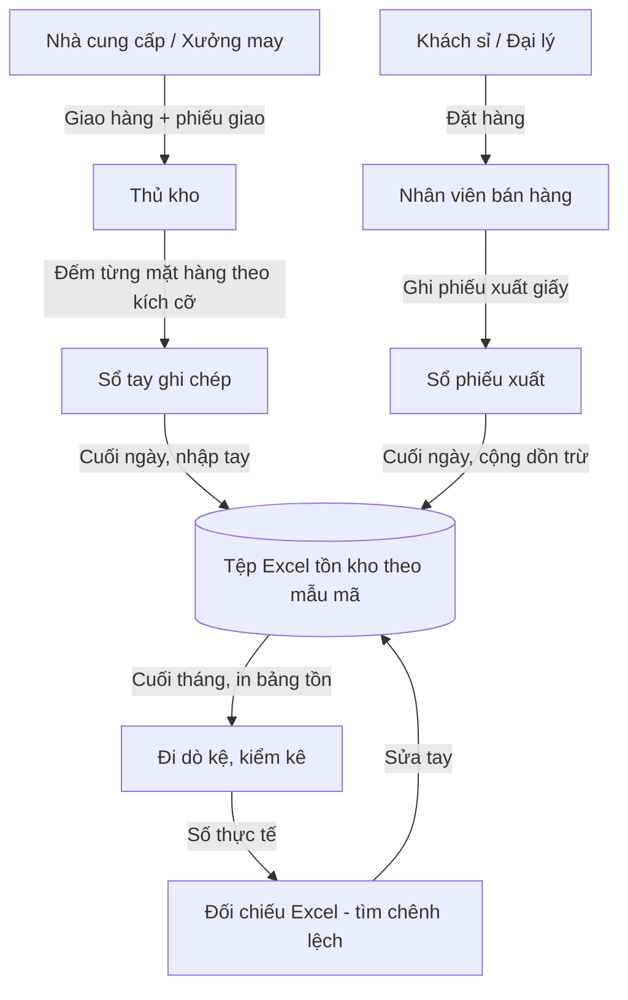
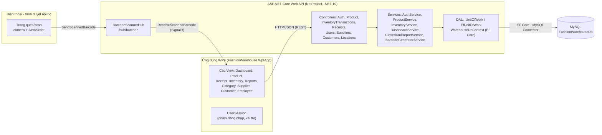
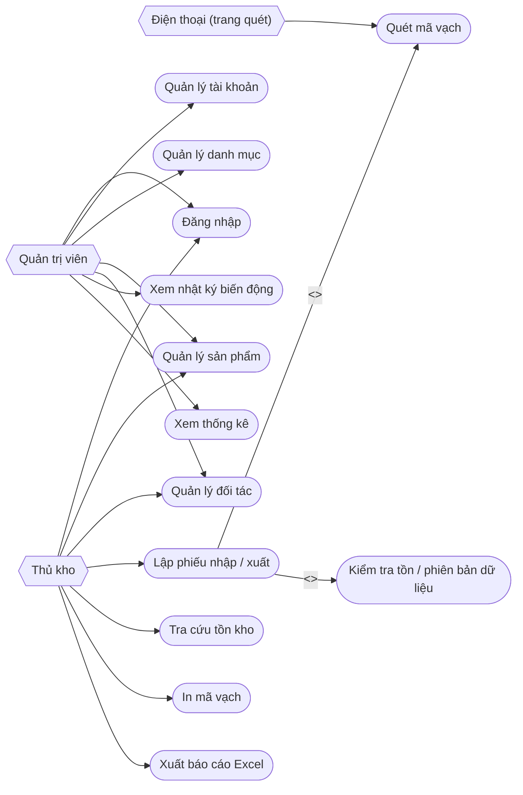
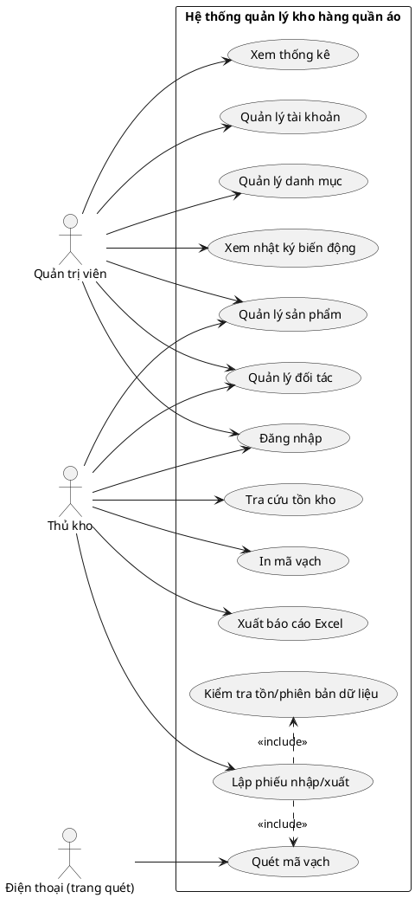
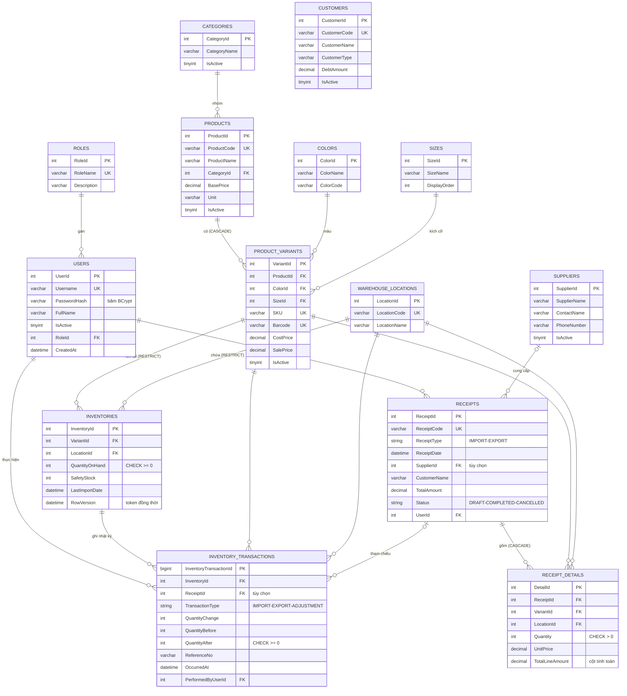
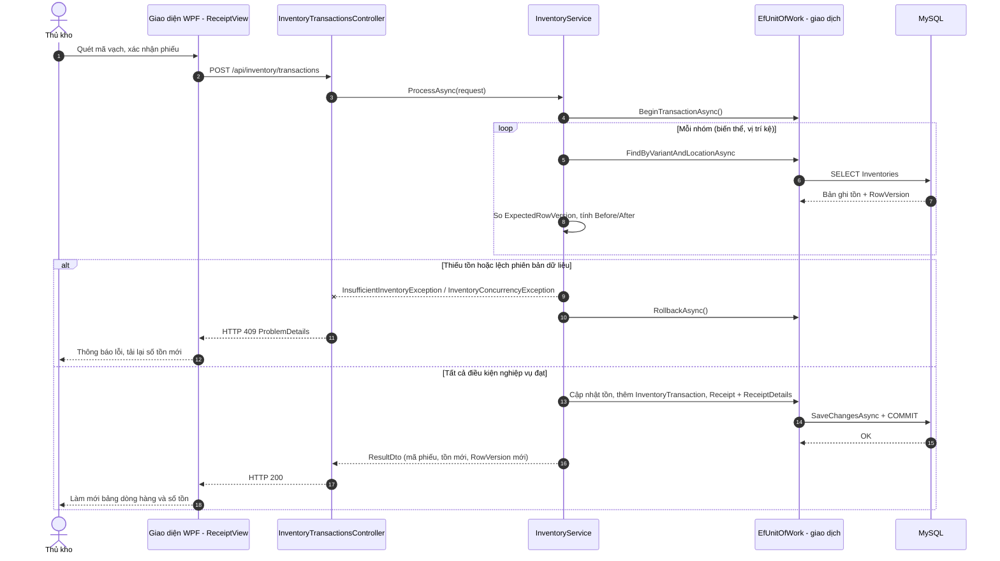
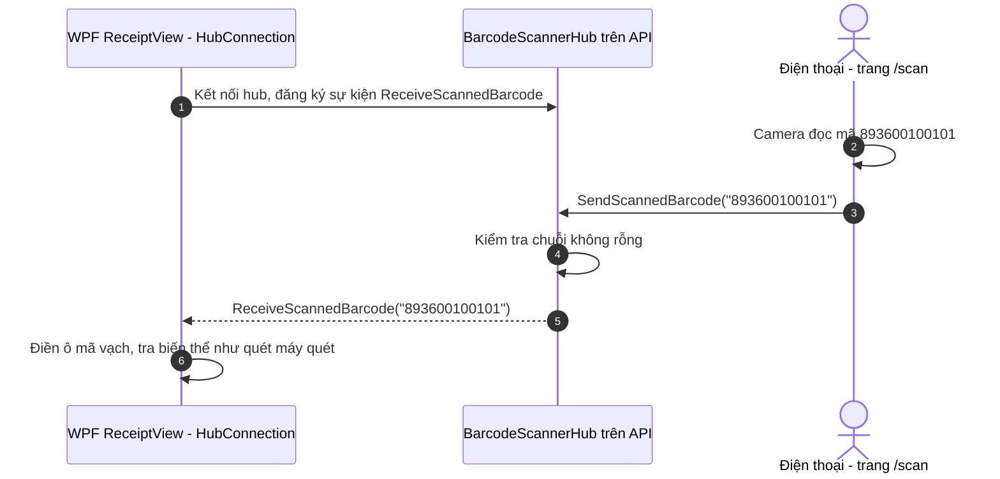

# MÃ MERMAID CÁC SƠ ĐỒ TRONG BÁO CÁO BTL

Cách dùng: dán từng khối mã vào [mermaid.live](https://mermaid.live), Typora, VS Code (có extension Mermaid) hoặc draw.io (Arrange → Insert → Advanced → Mermaid), rồi xuất ảnh PNG đặt độ phân giải cao (khuyến nghị Scale ≥ 2x) để chèn vào báo cáo.

---

## Hình 1.1 – Lưu đồ nghiệp vụ quản lý kho hiện tại của cửa hàng



---

## Hình 2.1 – Sơ đồ kiến trúc tổng thể hệ thống



---

## Hình 2.2 – Sơ đồ phân rã chức năng hệ thống

```mermaid
flowchart TD
    ROOT["Hệ thống quản lý kho hàng quần áo"] --> F1["Xác thực và phân quyền"]
    ROOT --> F2["Quản lý danh mục"]
    ROOT --> F3["Quản lý sản phẩm"]
    ROOT --> F4["Quản lý đối tác"]
    ROOT --> F5["Nghiệp vụ kho"]
    ROOT --> F6["Báo cáo – thống kê"]
    F1 --> F1a["Đăng nhập"]
    F1 --> F1b["Quản lý tài khoản"]
    F1 --> F1c["Gán vai trò"]
    F1 --> F1d["Đặt lại mật khẩu"]
    F2 --> F2a["Nhóm hàng"]
    F2 --> F2b["Màu sắc"]
    F2 --> F2c["Kích cỡ"]
    F2 --> F2d["Vị trí kệ"]
    F3 --> F3a["Tạo sản phẩm"]
    F3 --> F3b["Sinh ma trận biến thể"]
    F3 --> F3c["Sinh / in mã vạch"]
    F3 --> F3d["Tra cứu sản phẩm"]
    F4 --> F4a["Nhà cung cấp"]
    F4 --> F4b["Khách hàng sỉ"]
    F5 --> F5a["Nhập kho"]
    F5 --> F5b["Xuất kho"]
    F5 --> F5c["Quét mã vạch (máy quét / điện thoại)"]
    F5 --> F5d["Tra cứu tồn kho"]
    F5 --> F5e["Cảnh báo tồn thấp"]
    F5 --> F5f["Lịch sử phiếu"]
    F5 --> F5g["Nhật ký biến động"]
    F6 --> F6a["Tổng quan KPI"]
    F6 --> F6b["Biểu đồ nhập – xuất"]
    F6 --> F6c["Xuất Excel tồn kho"]
    F6 --> F6d["Dự báo cần nhập lại"]
```



---

## Hình 2.3 – Sơ đồ use case tổng quát

Mermaid không có dạng use case gốc nên dùng flowchart mô phỏng: lục giác là tác nhân, hình viên thuốc (viên tròn) là use case; cạnh có nhãn `<<include>>`.



### (Phương án thay thế – PlantUML use case thật, nếu muốn chuẩn UML)



---

## Hình 2.4 – Sơ đồ quan hệ thực thể (ERD) của cơ sở dữ liệu



---

## Hình 3.1 – Sơ đồ tuần tự xử lý phiếu nhập/xuất kho



---

## Hình 3.4 – Sơ đồ tuần tự quét mã vạch từ điện thoại qua SignalR



---

## Ba hình còn lại là ảnh chụp đoạn mã (không phải sơ đồ Mermaid)

Chụp màn hình các đoạn sau từ Visual Studio để chèn vào báo cáo:

**Hình 3.2 – Cấu hình token đồng thời trên entity Inventory** — `Data/WarehouseDbContext.cs` (dòng 117–123):

```csharp
// DATETIME(6) đổi mỗi UPDATE của MySQL; EF dùng giá trị cũ trong WHERE để phát hiện xung đột.
modelBuilder.Entity<Inventory>()
    .Property(x => x.RowVersion)
    .HasColumnType("datetime(6)")
    .HasDefaultValueSql("CURRENT_TIMESTAMP(6)")
    .ValueGeneratedOnAddOrUpdate()
    .IsConcurrencyToken();
```

**Hình 3.3 – Băm và đối chiếu mật khẩu** — `Services/WarehouseServices.cs` (dòng 11–16 và 30–37):

```csharp
public static string HashPassword(string password)
{
    return BCrypt.Net.BCrypt.HashPassword(password);
}
// ... trong VerifyPassword: chỉ giữ đường BCrypt cho bản vận hành
if (storedHash.StartsWith("$2"))
{
    return BCrypt.Net.BCrypt.Verify(inputPassword, storedHash);
}
```

**Hình 3.5 – Lớp trung tâm nhận mã vạch từ điện thoại** — `Hubs/BarcodeScannerHub.cs` (dòng 1–18):

```csharp
public class BarcodeScannerHub : Hub
{
    /// <summary>Được gọi từ trang Web trên điện thoại khi camera đọc được mã vạch</summary>
    public async Task SendScannedBarcode(string barcode)
    {
        if (!string.IsNullOrWhiteSpace(barcode))
        {
            await Clients.All.SendAsync("ReceiveScannedBarcode", barcode.Trim());
        }
    }
}
```
